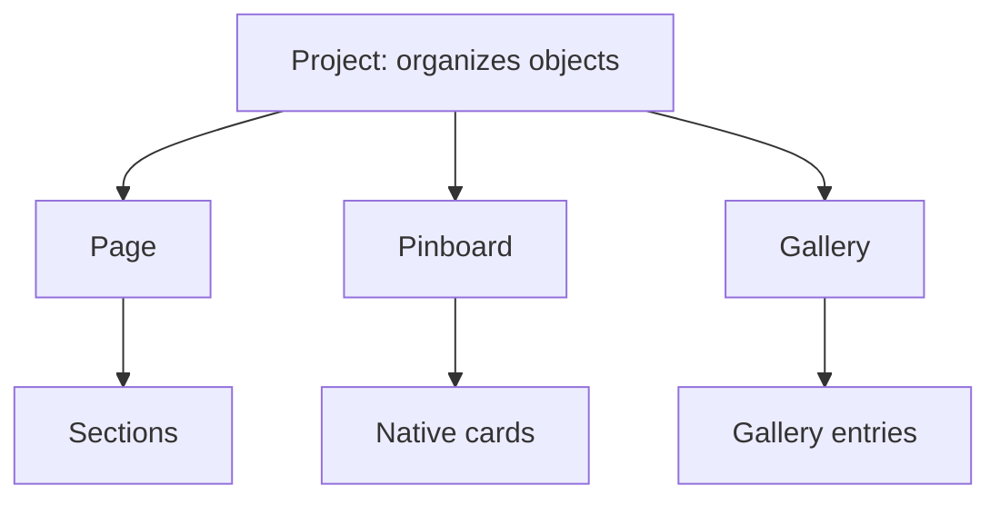

# Proposal — Object Grammar and Portable Atlas Expressions

**Status:** Owner-directed design principles and proposed contracts; not implemented or a validated canonical schema.  
**Recorded:** 2026-10-18 (America/Chicago).  
**Scope:** Add Item, containment, references, page composition, cards, slices, portable publishing and cold-agent inheritance.

## Owner's vision: beautiful expressions everywhere

The owner's dream is a future filled with **beautiful, aesthetic Atlas cards and Atlas slices across the internet, enduring indefinitely**. This is a guiding ambition, not a forecast, adoption claim or literal guarantee of permanence.

The intended opportunity is the **reduction of a rich whole into its best, most elegant representative parts**. A card or horizontal slice should convey the source's identity, meaning and character through an intentionally composed selection of content and useful interaction. These representations should travel effortlessly between Atlas templates, across the ecosystem, and eventually into unrelated websites and systems. Clicking can lead back to the full published object or reopen/import it in Atlas when supported.

The long-term product is therefore more than a destination: it can provide a recognizable, reusable publishing vocabulary. Earn adoption through beauty, usefulness, portability and durability. Do not make exported pieces depend on Atlas installation, a proprietary hosted service, or an ongoing subscription merely to remain readable. Preserve a useful independent representation when Atlas is absent or its source is unavailable.

## Core distinction: identity, structure and presentation

An object can have a stable content identity, an organizational parent and several presentations. These are separate facts. Opening something at a standalone URL does not change its type. Universal card representation does not confer universal containment permission.

| Concept | Role | Boundary |
| --- | --- | --- |
| Project | Carrier and joining principle for related work | Organizes actual objects, not merely their slices; no fixed visual layout is implied. |
| Page | Composed presentation made from Sections | May present full permitted content, slices, previews or custom Liquid expressions. |
| Section | A compositional place and arrangement | Can present any supported object/expression only through that type's permitted presentation rules. |
| Pinboard | Specialized collection of its native Cards | Cannot directly contain Pages, Projects or arbitrary Sections. It can open independently. |
| Gallery | Visual collection of gallery entries | Entry details and supported expansions must be defined explicitly; do not silently turn it into a universal container. |
| Card | Stable content identity/manifest and an accessible representation | Can hold/reference extensive content, assets, annotations and relationships beyond its initial visible face. References do not automatically become structural children. |
| Slice | Designed reduction of a referenced whole | Is a presentation contract, not a new owning copy of its source. |
| Preview | Inspection view of something | Does not necessarily create a saved embedding or structural relationship. |
| Style | Appearance applied to a presentation | Does not change content identity or object type. |

Pinboard restrictions and Project/Page/Section/slice roles are explicit owner direction. The detailed Gallery and Card containment boundaries above remain proposals requiring type-specific decisions. Do not invent unlimited nesting where an acceptance rule is missing.

## Structural map: parallel branches, not one nesting ladder

A Project may also organize another Project. Objects can exist without a Project. Being lower in this diagram does not mean every object above can directly contain it. A Page contains Sections; a Pinboard contains Cards; these are different branches.

The conceptual Venn view discussed with the owner describes **overlapping roles**, not ownership sets: the same Project/Page/Pinboard/Gallery may exist as a whole and be represented in another context. Slices, previews and custom expressions are ways to present that source. Overlap never grants new containment rights.

## Relationships are explicit verbs

| Verb | Meaning |
| --- | --- |
| Contains / organizes | Establishes the structural relationship allowed for those types. |
| Links | Offers navigation to another object. |
| Embeds / presents | Places an allowed expression of a source inside a host Section. |
| Copies | Creates an independently editable object, preserving appropriate lineage. |
| References | Shares the existing source identity rather than duplicating ownership. |
| Transforms | Produces a permitted derivative presentation or independent variation under explicit rules. |

Ownership, location and appearance must not be inferred merely because two objects appear beside each other. A Project holding a Page and a Pinboard joins those real objects; by default its presentation can show slices of both. That default does not replace them with slices or force every Project to use the same index layout.

## Plain-English conditional rules

- **If** a Project contains a Page **and** a Pinboard, **then** both belong to that Project, **but** retain their own identities and content.
- **If** a Pinboard opens as a standalone destination, **then** it remains a Pinboard; it does not become the composed Page type.
- **If** the current container is a Pinboard, **then** Create New offers a native Card, **not** a Page, Project or arbitrary Section.
- **If** a Page needs to show a Pinboard, **then** one of its Sections can present a permitted Pinboard slice/embedded view.
- **If** a Section shows an object, **then** the source type and host constraints jointly determine the permitted expression. “Anything” means supported content, not unlimited nesting.
- **If** someone edits a slice's crop, excerpt, layout or typography, **then** only that host-specific expression changes; its source is not overwritten.
- **If** the source changes **and** its slice is live-linked, **then** the slice may update according to its contract. **If** the slice is a snapshot, **then** retain the recorded source version.
- **If** someone copies a source, **then** the copy is independently editable. A link or live reference still refers to the original.
- **If** Liquid defines a custom expression, **then** it may customize permitted presentation, **but not** bypass content types, privacy, reference or security rules.
- **If** containment or embedding would create a cycle, **then** reject that relationship. Ordinary navigation links can point back without becoming containment.
- **If** a source is private or unavailable, **then** embedding cannot make it publishable or grant access.
- **If** a representation becomes smaller or changes shape, **then** adapt its composition while preserving identity, meaning, usability and aesthetic quality—not identical pixels.
- **If** a type pair or expression has no defined rule, **then** mark it unsupported/pending rather than silently allowing it.

## Add Item must express this grammar

The reported dialog flattens object type, format, style and bookmark source into unrelated-looking dropdowns. Fixing it means applying a small rule framework, not merely changing padding.

1. **Action:** Create New, Add Existing, or Embed Existing. Do not silently make Add Existing mean either copy or link; label the actual relationship when needed.
2. **Object:** offer only types permitted in the current location and action.
3. **Presentation:** offer compatible format/layout/style choices, followed by a relevant starting-content source.

Examples: inside a Project, create/add a Page or Pinboard. Inside a Page, create a Section; in that Section choose Embed Existing → Pinboard → board → allowed slice. Inside a Pinboard, create a Card. Pinboard formats must not show unrelated Story/Horizon choices. Bookmark collection choice appears only when that source actually supplies initial content.

Keep the current location visible, with an understandable object/action label and a compact summary of dependent choices. Use familiar icons, readable type, shared edges, comfortable spacing, a preview when it helps, existing light/dark appearance, and one clear primary action. Start finished through sensible presets. Do not expose internal schema or framework terminology in ordinary creation flows.

Proposed implementation boundary: a small declarative type/relationship/presentation rule registry shared by the dialog, mutation validation and export validation. UI filtering alone is not enforcement. Keep canonical data, presentation rules and platform rendering separate; avoid building a large generic engine ahead of one working slice. Existing persisted structures require inventory and explicit migration/compatibility handling before enforcing new restrictions.

## A slice is a design discipline

A slice is not necessarily a thumbnail, iframe, screenshot or shrunken whole page. It selects what matters and recomposes it for its host. A horizontal slice and a compact Card can express the same source differently. Record what was selected, omitted or transformed, and why. Preserve an appropriate route to the whole.

Use the existing presentation-IR/template/Any-Shape proposal rather than inventing a second rendering pipeline. Good expressions should carry their design logic as well as their output: hierarchy, crop, excerpt, typography, image treatment, responsive behavior, interactions, rights and source/version provenance. Aesthetic quality is an acceptance criterion across supported sizes, not decoration after technical fit.

## Portable expression contract

Three concerns must travel coherently:

| Part | Required information |
| --- | --- |
| Content | Selected text/assets, source identity/version, relevant semantics and permission-safe references. |
| Presentation | Layout, typography, design tokens, responsive rules, asset references and only the interactions actually needed. |
| Connection | Link to the full published object; optional portable identity/deep-link/import information for supported Atlas clients. |

HTML/CSS/JavaScript make this feasible, but do not guarantee portability alone. Isolate styles from host collisions, scope scripts/events, resolve assets without browser-profile blob URLs or companion-only addresses, preserve keyboard/touch accessibility, and define security behavior for custom code. Use progressive enhancement: static expressions should need zero JavaScript when their purpose permits. Never export credentials or private linked material. Choose an embedding technique based on demonstrated host compatibility rather than promising one mechanism works everywhere.

Exports should remain useful without Atlas installed. Opening the whole can lead to an ordinary published URL; opening/importing in Atlas is an additional supported capability, not a prerequisite. Keep source attribution and rights where required. Define graceful unavailable-source behavior and distinguish independent snapshot assets from live references. Reuse/export must not mutate original content or silently inherit unrelated image tags, notes, recommendations or publication permissions.

## First proof and acceptance gates

The first portable-expression proof is **one excellent Card and one excellent horizontal Slice**, representing a real whole, exported into unrelated host websites and working without Atlas installed.

- Verify whole/source identity, version and click-through/import semantics.
- Demonstrate independent whole and host-specific expressions without accidental source mutation.
- Validate allowed/forbidden containment and embedding, including cycles and private content, through shared rules at both UI and persistence/export boundaries.
- Show Add Item offers understandable valid choices for Project, Page/Section and Pinboard contexts; incompatible formats never leak into the list.
- Test host CSS collisions, asset failures, restrictive script conditions, keyboard/touch, reduced motion and supported small/large container sizes.
- Record output size, dependencies and actual runtime behavior on constrained hardware. Do not infer portability from a screenshot or one Atlas template.
- Reconstitute the expression from documented inputs, presentation rules and exported artifacts with an unfamiliar agent.

## Scope and continuity

This document consolidates the owner's discussion after the minimal-publishing proposal. It does not implement the Add Item redesign, a new type system, a portable embed package or an external adoption standard. Preserve existing user data and proven features while introducing one verified slice at a time. Existing note/linked-bookmark bugs, additive per-image isolation and tagging/recommendation proposals remain separately tracked.

Related: [Minimal Publishing and Adaptation Corpus](PROPOSAL_MINIMAL_PUBLISHING_CARD_SLICE_ANY_SHAPE_CORPUS.md), [Adaptive Publishing](PROPOSAL_ADAPTIVE_PUBLISHING_AND_PRESENTATION_SYSTEM.md), [Additive Image Entries](PROPOSAL_ADDITIVE_IMAGE_ENTRIES_AND_RECOMMENDATIONS.md), [Current Card Workspace](CURRENTLY_WORKING_ON_CARD_WORKSPACE.md), [Investigation Backlog](../backlog/README.md).

## Explicit owner clarification — extractable from inception

**Every Card, expanded/popup Card and Slice we design is intended from the outset to be extracted and reused elsewhere.** Portability is a construction requirement, not an export feature to retrofit after an interface becomes entangled with Atlas.

Each component must identify its portable content/presentation/interaction core and its host adapters. Inputs, events, assets, styles, transitions and required capabilities must be explicit and modest. Chrome APIs, companion pairing, catalog persistence, model generation and publishing authorization belong behind replaceable interfaces. Reusing a popup must not require importing the whole extension or duplicating its global state. Preserve its underlying states/transition semantics while allowing another host to render it inline, expanded or as a dialog.

This does not mean every host can perform privileged editing or local inference. Supply a working independent viewing mode; enable editing/generation only through available authorized adapters and give honest unavailable states. Export a selected, permission-safe presentation rather than all private card content. Components may share a small declared dependency package; do not demand a separate duplicated runtime for each card. Prove extraction with standalone fixtures and an unrelated host, including responsive appearance and necessary interactions, before claiming it is complete.

## Explicit owner principle — every size, every host

**Whatever its size, a Card, popup/expanded Card or Slice must remain functional, understandable and aesthetically intentional on phone, tablet and desktop, including when embedded in a differently sized container.** The ambition is a portable adaptive Atlas format, not a set of desktop screenshots scaled down. This extends the extractable-from-inception requirement: extraction and size adaptation are designed together.

Adapt to the component's available container as well as the device viewport. Recompose hierarchy, crop, typography, spacing, controls and transitions rather than shrinking text or clipping required content. Preserve content identity, meaning, reading order, accessible keyboard/touch interaction and the route to the whole. A small representation may deliberately select less content and disclose more on expansion; it must make that selection explicit and never silently lose the underlying content. Where controls cannot fit, use a coherent alternate arrangement or expansion path instead of unusably tiny targets.

Use the existing Any-Shape adaptation contract and shared presentation rules. Document supported minimum/maximum envelopes and graceful behavior outside them: no finite component can display unlimited content inside literally zero space. This engineering boundary must not become an excuse for testing desktop only. Include narrow/wide phones, tablets, desktop, narrow embedded containers on wide screens, large text/zoom, long titles, missing assets, touch/keyboard and reduced motion. Record visual and functional evidence at those sizes; no claim of universal correctness follows merely from media queries or a handful of screenshots.

**Format ambition:** source identity/content + portable expression + adaptive behavior + verifiable quality across hosts and sizes. Call it a proposed Atlas format until its schema, compatibility/versioning contract and independent implementations/export proofs are established; widespread standard adoption remains a goal.
