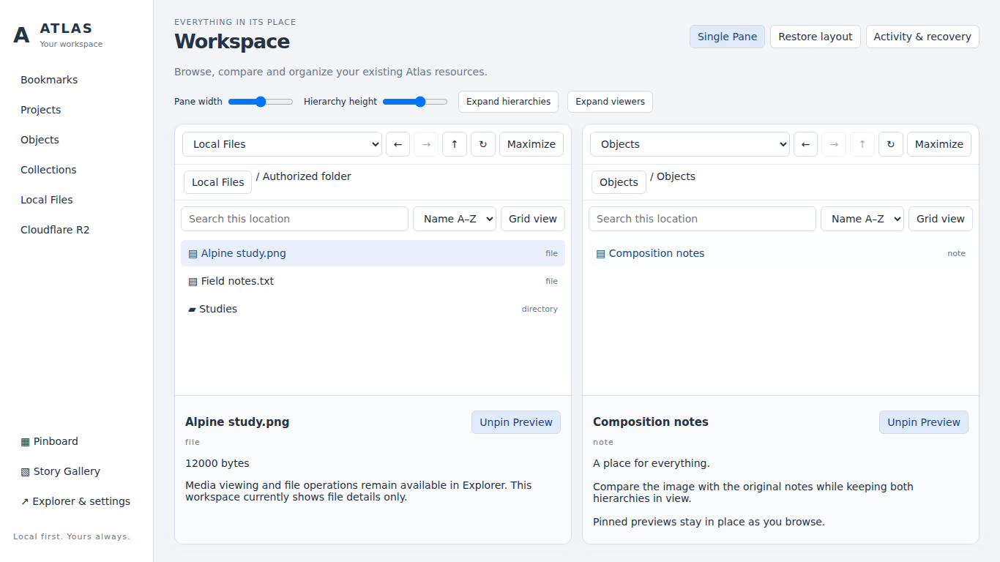
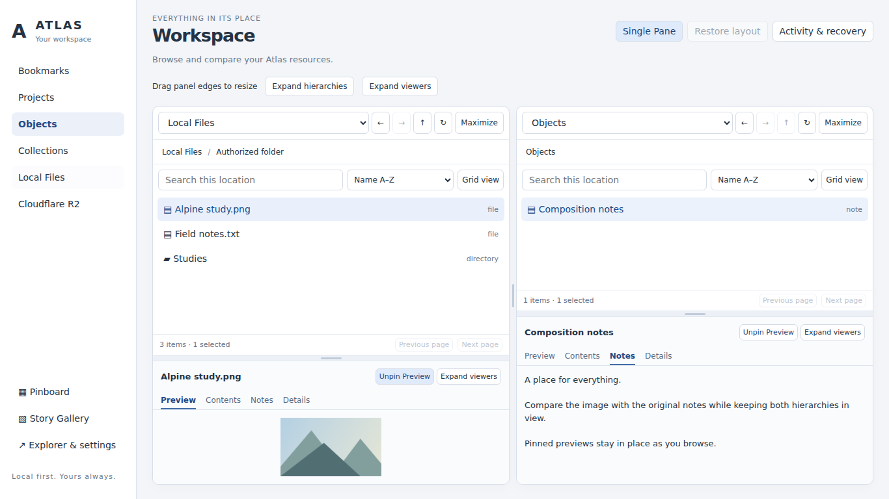

# Workspace Stage 2 — resizable comparison workspace

Owner request: [complete Stage 2 brief](../requests/ATLAS_WORKSPACE_STAGE_2_VISUAL_AND_INTERACTION_COMPLETION.md). Baseline main: `76070f0` (includes merged PR #4). This supersedes the layout/preview limitations in WORKSPACE_DASHBOARD_V1.md; it does not complete the full original dashboard brief.

## Preserved contract and architecture

Fixed: source identities and content, bookmark/page/catalog separation, existing Shelf launcher, pinboard, Story Gallery, setup/recovery, authorization and scoped read routes. No provider write, permission, native connector, storage-content migration, entitlement, R2 or Puck change.

Constrained: 200 rendered rows per page; local listings retain the existing 20,000-entry bound; workspace previews cap native images at 8 MiB and text at 512 KiB. Fluid: DOM/CSS layout, view state and layout-preference representation. Existing `atlas.workspace.layout.v1` remains readable: old `height` migrates into two independent `heights` values. New preferences contain only dual mode, pane width and the two heights. Locations, pins and history remain session state, not persisted credentials or grants.

The same explorer/provider architecture from PR #4 remains. `workspace-splitter.js` owns pointer capture and keyboard edge behavior; `workspace-preview.js` owns bounded, nonmutating content rendering; `workspace-menu.js` exposes only view/open commands. No frontend framework or new runtime dependency.

## Implemented behavior

- Direct vertical edge between side-by-side panes; independent horizontal edges above each content viewer. Visible grips, hover/focus, col/row cursors, pointer capture and touch action suppression. Width bounds preserve a useful minimum; height bounds keep hierarchy and viewer reachable. Normal split mode has no fixed panel height/width.
- Mouse and touch dragging, arrow adjustment (Shift for larger steps), Home/End bounds, Enter/double-click default reset. ARIA separators expose orientation and value. Layout writes are serialized snapshots, not one write per pointer move.
- Saved width and two independent heights survive reload. Responsive layouts stack panes below 1051px, where a left/right width edge would not make sense; each hierarchy/viewer edge remains usable. Normal 1366×768 presents the intended 2×2 layout.
- Expand top regions or bottom viewers across the workspace for side-by-side organization/comparison; maximize either full pane; visible restore and Escape. These only change presentation. Pane nodes remain mounted, so selections, pins, source locations, history, scroll and custom ratios survive restoration.
- Preview / Contents / Notes / Details tabs, keyboard tab navigation, pinned content in both panes. Existing embedded bookmark/project covers, bounded native image/text reads, saved notes, resource details and existing related-resource/collection membership lists. Text renders as text, never HTML. Stale reads cannot populate a newer viewer; blob URLs are revoked when released. Pin and layout changes do not reread the selected image.
- No automatic download of remote originals. Unsupported media falls back to details/source links; existing Explorer remains available for other media or larger previews. Local file reads go through the unchanged authenticated extension-worker route; a locator is not treated as a grant.
- Full ancestor navigation for Chrome bookmark folders and local relative folders; independent pane history, filter and sorting. Name/type sorting; size/modified sorts exposed only for real local folder listings. Native Ctrl/Meta/Shift selection, Arrow/Home/End selection/focus, Enter open, Ctrl/Meta+A, Ctrl/Meta+F, Alt+Left/Right/Up and F5.
- Safe right-click menu: Open, Preview, Pin Preview, Properties. Keyboard menu traversal/Escape/outside dismissal. No fake Copy/Move/Transfer/Delete commands.
- Bounded 200-row pages, real counts/selection feedback, synchronized active-provider navigation, clean read-only errors, compact toolbars, responsive navigation, restrained reduced-motion-compatible styling.

## Executed evidence

[Receipt and source digests](../evidence/workspace-stage2/verification.json) distinguish direct proof from gaps.

- Actual **Chromium 153.0.8010.0**, Linux, headless: `scripts/test_workspace_browser.mjs` passes. This drives real pointer mouse and touch events on visible edges and measures changed adjacent rectangles; checks independent heights, Chrome-like storage fixture reload, keyboard/default reset, pinned image/note comparison, expand/restore, text preview, menu, pagination, breadcrumbs, denial/unsupported states, Shelf HTML/JS launcher and narrow/reduced-motion rendering. Chrome/provider APIs are explicitly synthetic here. This is real rendering/input proof, not native transport or installed MV3 proof.
- `scripts/test_workspace.mjs`, `test_workspace_ui.mjs`, `test_workspace_preview.mjs` pass (model/API/DOM doubles; bounded preview security and stale-result checks).
- Standard Node sweep: 25 suites pass, 1 pre-existing native recovery integration fails at line42, 2 optional browser/MV3 suites skip without a configured Playwright dependency. The configured Chromium suite passes separately.
- Required `python scripts/check_project.py`: 22 model records link; 170 tests, failures3/errors3/skips33. Native bootstrap/supervisor startup/READY failures match the recorded container baseline. No native code changed; do not label the full suite green.
- JS syntax, whitespace and unsigned extension packaging pass.

## Before / after

Screenshots use generated synthetic research data, never user files. Baseline is main `76070f0`; after uses the Stage 2 source. Different split ratios in the after view demonstrate independent heights.

| Baseline | Stage 2 |
| --- | --- |
|  |  |

[Narrow comparison, 900px](../evidence/workspace-stage2/comparison-900.png) · [390px](../evidence/workspace-stage2/comparison-390.png). At narrow sizes panes stack and scroll rather than compressing two explorers into unreadable columns.

## Explicit qualification gaps

The local browser is a Chromium headless-shell build: loading the actual extension did not produce a serviceworker within the test timeout. Full installed MV3, actual Chrome side-panel/action activation, Windows, and real helper preview reads are **NOT_RUN locally**. The browser tests exercised the real Shelf markup/launcher with synthetic Chrome APIs, not an actual installed side panel. Screen-reader/device testing and 4 GB memory benchmarking remain unqualified.

CI adds a separate full-Chromium job with two commands: synthetic-provider browser interaction tests and `test_workspace_mv3.mjs` with `ATLAS_REQUIRE_MV3=1`. The latter uses a fresh isolated profile and real native Chrome bookmarks, worker, Shelf launcher, edge drag and Chrome storage. No real user profile is inspected. Treat hosted results as pending until a run succeeds; never transfer synthetic-provider PASS to the MV3/native gate.

## Deferred work and next step

Collections remain the existing flat companion catalogs. Nesting is deliberately deferred: extend the strict versioned catalog format with migration/revision semantics, parent/member identity rules and server-enforced cycle validation; prove export/import, shared memberships and removal without source deletion before adding editing UI. No shadow browser-local Collections store.

Also deferred: R2 backend/transfers, cross-pane reference mutations, Collection-as-resource migration, Home aggregation, persisted pane content/history across restart, generalized remote image delivery, richer media previews, sorting-column headers, full virtualized data fetching and editable notes in the new viewer. Existing features stay accessible in Explorer.

Manual continuation: load `extension/` in desktop Chrome; open real Shelf ↗, compare actual granted images and Objects notes, drag all three edges (mouse/touch where available), pin both, expand/restore and reload. Check grants/revocation, Story Gallery/pinboard/settings and OS/browser lifecycle. Record browser/OS, screenshots and observations before closing backlog023 or calling this release-qualified. Do not merge automatically.
