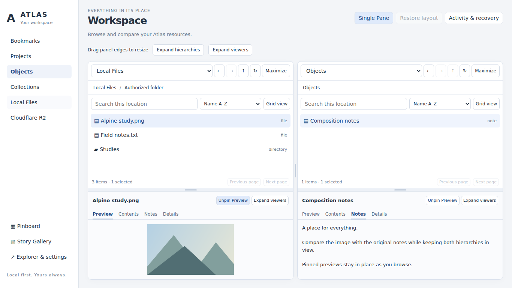
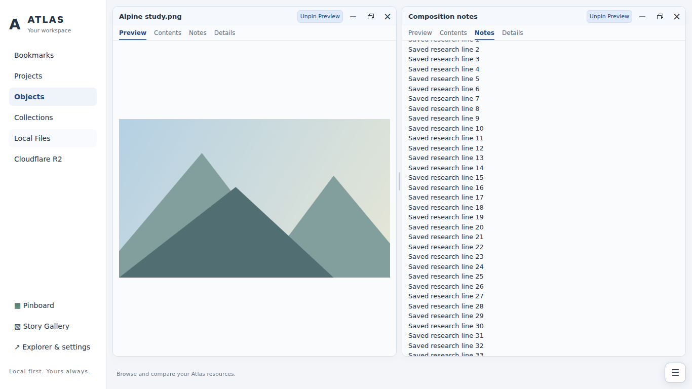

# Workspace window controls and adaptive commands — Section 5A

Owner direction: latest Section5A of [Stage 2 request](../requests/ATLAS_WORKSPACE_STAGE_2_VISUAL_AND_INTERACTION_COMPLETION.md), baseline main `5226a15`. Extends the shared explorer from merged PRs4/5; no replacement of providers or source models.

## Implemented contract

- Consistent title-bar controls in **− / □ / ×** order, with native buttons, tooltips and labels. Minimize retracts a hierarchy/viewer into its recognizable bar. Maximize becomes the overlapping-box Restore control directly on that region. Main title-bar Close removes the column view; viewer Close removes only the viewer. No close action deletes content or stops jobs. The last main pane cannot close.
- Dual Pane reopens a closed column with its existing DOM, provider, selection, history, pins and scroll. Single Pane keeps the active column. Closed viewer regions can be recovered through Show content viewers or Restore layout. View modes are session state, not new resource records.
- **Actual viewport-height maximize:** focused regions start at the top of the dashboard area, replacing the introductory header's occupied space. Desktop sidebar remains usable. One maximized region fills its column; commands occupy a fixed compact toolbar at the top of the other column. Two maximized regions compare side by side without the intro header. Full-pane focus remains available through the same commands.
- When no free toolbar column exists (two regions, full-pane focus or narrow-screen focus), shared secondary commands use the bottom-right three-line dock. The dock has a reserved footer slot, so the resting launcher does not obscure content, a scrollbar or a splitter. The expanded flyout is a conventional temporary overlay; it closes through Escape, outside click or delayed departure. Restore always remains on the region itself.
- One command map backs normal toolbar, dock and regional layout actions. The flyout exposes Single/Dual Pane, Restore layout, Activity & recovery, hierarchy/viewer maximize, left/right focus and Show content viewers. Activity uses the existing actual Activity trigger, not a second recovery implementation.
- Launcher remains visible at rest (opacity0.8, never0), returns to full contrast on hover/focus, and opens by click/tap or keyboard. Flyout keyboard traversal and Escape focus return work. Forgiving1400ms dismissal requires both pointer and focus to leave. A modal dialog blocks automatic dismissal and layout-Escape; closing it resumes ordinary menu handling. Reduced motion, narrow widths and safe-area placement are respected.
- Explicit snapshots restore split ratios and scroll positions after viewport geometry changes. Pane objects, selections, preview identity, pins and histories are not reconstructed. Temporary focused width resizing does not overwrite the saved normal layout. Restoring does not undo explicit navigation/content changes made while focused: scroll is restored only when the corresponding location/preview identity is unchanged.
- At narrow widths, one focused region occupies the viewport rather than remaining below an offscreen neighboring pane. Restoring reinstates the stacked layout. Both focused columns remain scrollable stacked regions when side-by-side comparison would be unreadable.

## Preservation and constraints

Fixed: resource identities, source data, permission boundaries, Shelf launcher, bookmarks, pinboard, Story Gallery, setup/recovery, provider APIs and active background jobs. Constrained: existing200 rendered rows/page, local listing and preview limits from Stage2, normal-layout preferences. Fluid: window presentation/session snapshots, title-bar controls, command placement and flyout lifecycle. No native/provider writes, new permissions, Puck, R2 or premium-entitlement changes. No new production dependency.

Implementation: `workspace-window-state.js` models presentation only; `workspace-windows.js` applies it without remounting pane content; `workspace-command-dock.js` manages one shared command surface. Existing explorer, preview, splitter and provider modules remain in use. Detached title controls are pruned; memories are bounded by the two panes/regions. Historical Stage2 records remain intact.

## Verification and evidence

Exact receipt, digests and screenshots: [verification.json](../evidence/workspace-window-controls/verification.json).

- `test_workspace_windows.mjs`: PASS session modes, independent maximize/restore, minimized-state preservation, close/reopen, active Single Pane and last-pane protection.
- Existing workspace model/provider, renderer-DOM and bounded-preview suites: PASS.
- `test_workspace_browser.mjs`: PASS in actual Chromium153.0.8010.0, preserving edge drag/touch, sorting/search/selection, pinning, pagination, breadcrumbs, errors and responsive behavior. Provider/Chrome APIs are synthetic.
- `test_workspace_window_browser.mjs`: PASS actual geometry/input tests for minimize/restore; one/both region viewport maximize; fixed toolbar reflow; temporary focused resize and exact width/height/scroll/pin/selection restoration; close/reopen either column; last-pane protection; visible idle dock; hover/focus/delay; keyboard Escape/focus return; Activity modal protection; touch activation and390px reduced-motion layout. No physical source write is submitted.
- Standard Node sweep:26 PASS,1 pre-existing native recovery integration FAIL at line42,3 optional browser suites SKIP without configured Playwright. Configured rendering suites pass separately. Local Python:170 tests, failures3/errors3/skips33 in the documented native bootstrap/supervisor startup baseline;22 model records link. This is not a green local full suite.
- Syntax, whitespace and unsigned extension packaging pass.
- Full MV3 runs in a separate required CI gate. Its smoke now also checks actual extension-window maximize/restore, command dock and close/reopen using real Chrome worker/bookmarks/storage. Hosted results are pending until explicitly recorded; synthetic-provider PASS is not MV3/native proof.

| Before, 1366×768 | Two viewers maximized, 1366×768 |
| --- | --- |
|  |  |

[Normal controls](../evidence/workspace-window-controls/normal-1366.png) · [One maximized viewer and fixed toolbar](../evidence/workspace-window-controls/one-maximized-1366.png) · [Narrow maximized view](../evidence/workspace-window-controls/maximized-390.png). All pictured data are synthetic browser fixtures, not personal files.

## Remaining qualification and scope

Real desktop helper image reads, native Chrome side-panel browser chrome, Windows GUI, physical touch hardware, screen-reader sessions and4GB memory budgets remain separate acceptance work. Local Chromium is a headless-shell build; installed MV3 cannot start there. CI uses full Chromium and an isolated temporary profile.

This request does not complete nested Collections, R2/cross-pane mutations, broader media, editable workspace notes or the full original dashboard brief. Backlog023 remains open. Continue desktop smoke with actual granted images/notes, open both regions, drag all separators, pin, minimize/maximize/close/reopen, verify exact restoration and hover/focus/dialog interactions. Record actual OS/browser and outcomes before claiming desktop qualification. Do not merge automatically.
